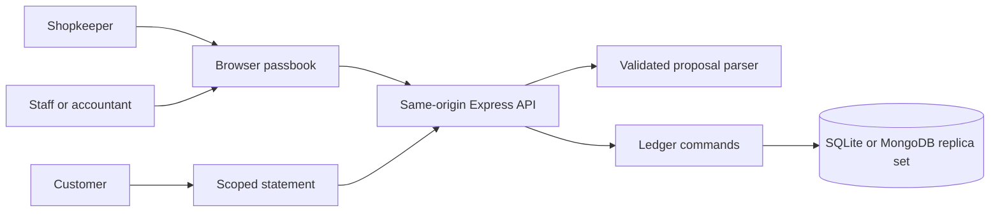

# Architecture

## Posting

Review a draft → submit a fresh idempotency key → validate amount, date and account pair → check shop and period → insert one immutable paired entry, its chained event and the key result in one transaction. A matching retry returns its original result. A conflict rejects the request. Reversal swaps the two accounts and links back to the original.

## Attestation

An owner issues a customer capability → the customer opens the fragment link → the browser sends the secret in a request header → the API checks its digest, scope, expiry and revocation → the customer's attestation joins the shop's audit chain. Updating the books requires an owner or staff session. Revocation invalidates the capability.

## Reconciliation

The browser reads a user-selected synthetic CSV locally and submits bounded text. The server parses quoted fields, compares unreversed posted receipts within a date window, scores amount and customer evidence and returns suggestions. Equal top candidates remain unmatched. A receipt can contribute to one match per comparison. Suggestions do not cause postings.

## Data and operations

The journal stores one positive integer amount shared by the debit and credit legs. It derives account balances from these entries. Shop/date indexes support statement ordering. Unique reversal indexes prevent duplicate reversals. Audit events have a per-shop predecessor digest. MongoDB serializes writes on the shop document inside a snapshot transaction; the SQLite adapter takes a write lock. Ledger and audit queries currently load the entire synthetic shop. Archive, cap or paginate larger histories before increasing workload.

If the server sleeps, Render wakes it on a real request. If storage fails, reads or writes fail and the client can retry. Local SQLite snapshots use VACUUM INTO and are verified by the restore test. The hosted SQLite volume is disposable. No scheduled remote backup runs.
